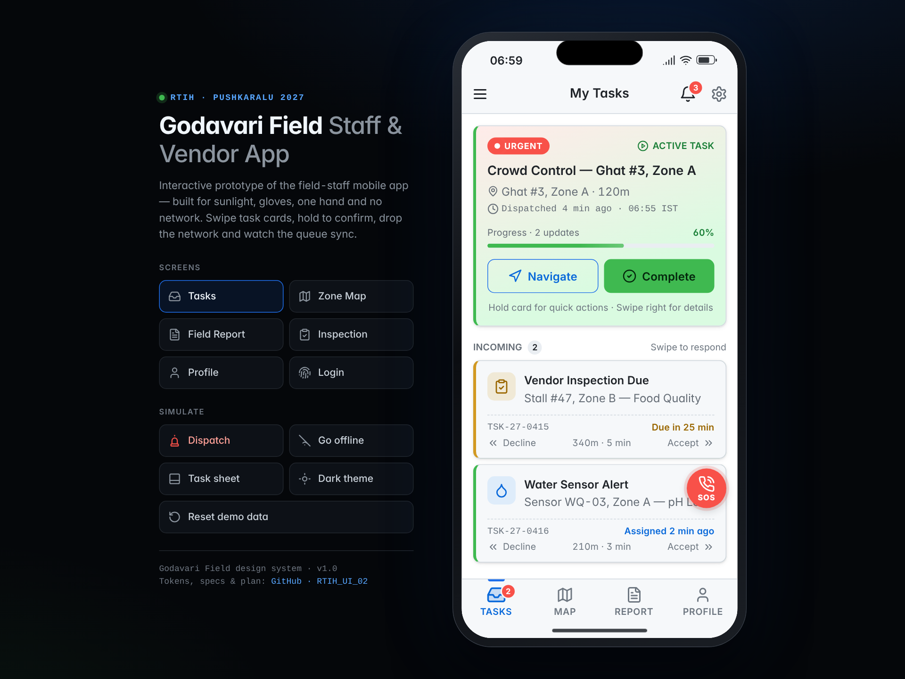
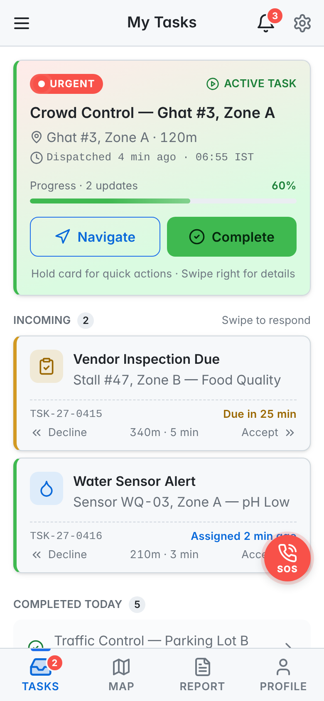
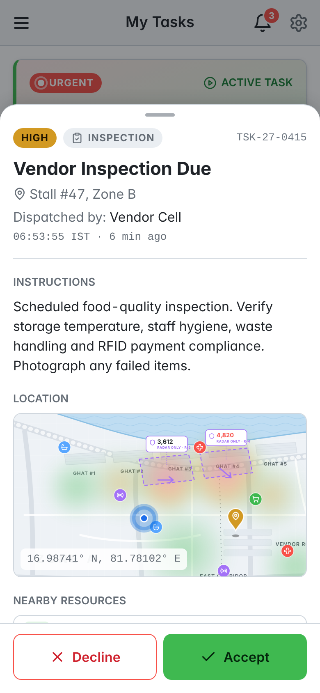
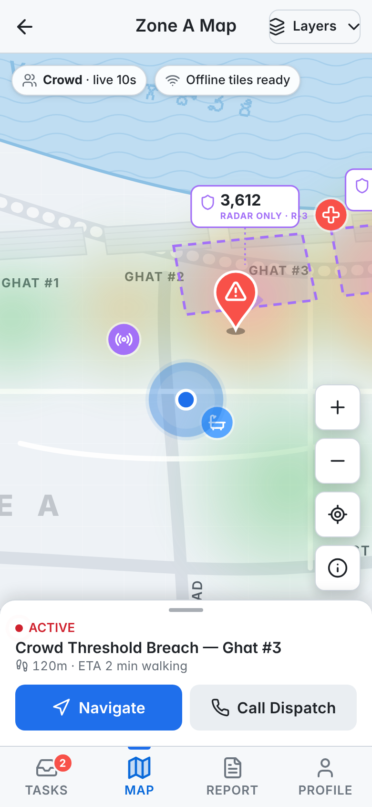
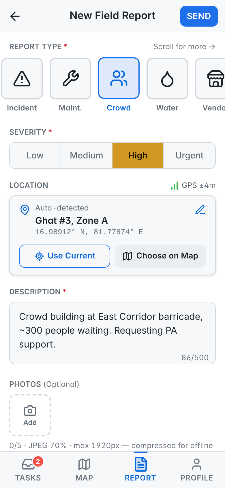
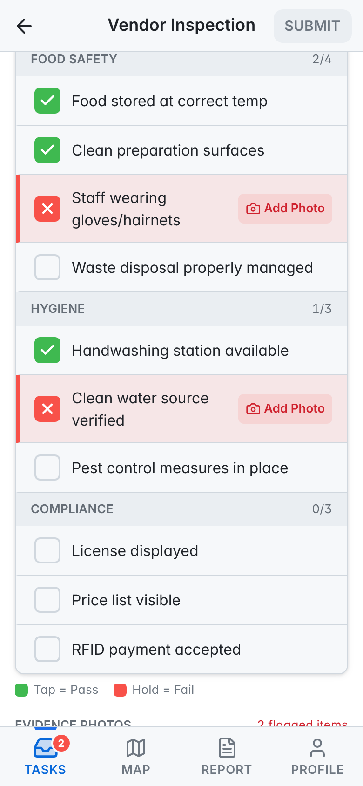
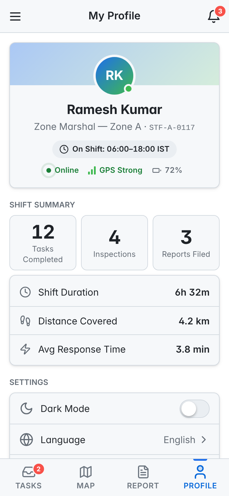
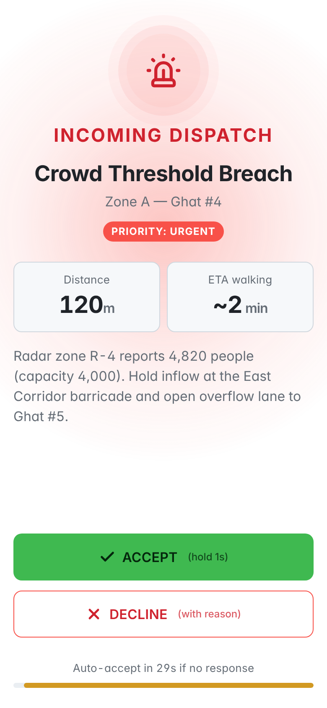
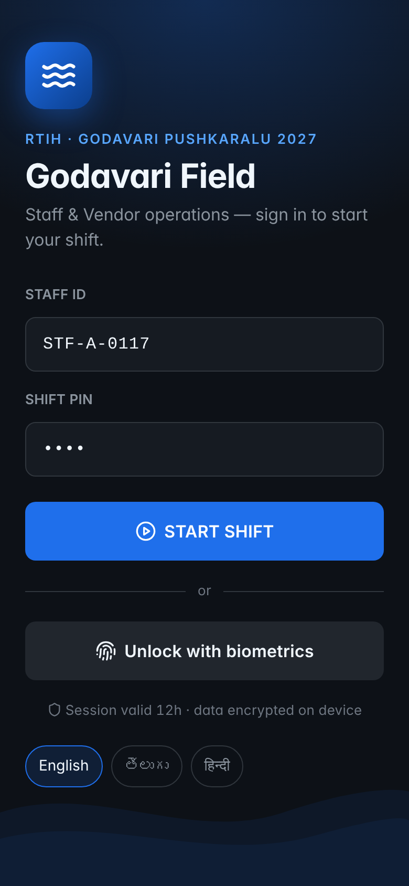
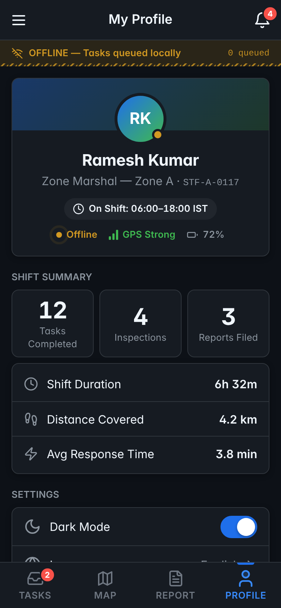

# Godavari Field · RTIH Pushkaralu 2027 Staff & Vendor App UI

The interactive UI for the **RTIH AP Godavari Pushkaralu 2027 Staff & Vendor Mobile App**, built strictly from the [UI Brief](docs/brief/UI_BRIEF.md) (Part A) using the custom **Godavari Field** design system.

The field staff it's for are Zone Marshals, Traffic Controllers, Medical Teams and Vendor Inspectors. They work 8–12 hour shifts outdoors, often in direct sunlight, with one hand free, sometimes wearing gloves, and with network coverage that comes and goes. Every screen is designed around those conditions.

**Live app:** https://rtih-ui-02.vercel.app (deployed on Vercel; every push to `main` redeploys automatically)

**Figma design:** [RTIH_UI_02 — Godavari Field Staff & Vendor App](https://www.figma.com/design/L0IhZZNuQwNLJpBzUgdLN6). It contains variables with Dark and Light modes, text and effect styles, 68 icon components, the component library, 8 screens, and 6 state/flow frames.



| Tasks | Task sheet | Zone Map | Field Report | Inspection |
|---|---|---|---|---|
|  |  |  |  |  |
| **Profile & Shift** | **Dispatch overlay** | **Login** | **Offline** | **Light theme** |
|  |  |  |  |  |

## What's inside

| Brief section | Implemented |
|---|---|
| §1 Principles P1–P6 | Primary actions within 3 taps, 48px+ targets, thumb-zone actions, dark default, offline queue, haptic patterns, `prefers-reduced-motion` |
| §2 Tokens | `src/styles/tokens.css` ↔ `tokens/tokens.json` (W3C DTCG). Dark and light themes. Contrast checked by tests |
| §3 Shell | 56px header (menu/back, centred title, bell + badge, gear), 64px tab bar with active pill and badge, animated offline → syncing → synced bar |
| §4.1 Tasks | Active card (progress, Navigate, **hold-to-Complete**, 1s long-press quick actions, swipe right → details). Incoming cards swipe **right = Accept / left = Decline + reason** (80px threshold, scaled underlay, haptic). Up Next, Completed Today, pull-to-refresh, SOS (1.5s hold) |
| §4.2 Zone Map | Offline vector map: blue pulse "you", bouncing task pin, facilities, crowd heatmap, **radar zones shown as counts + flow arrows only** (privacy §1.3), zoom/re-centre/legend, layer toggles (Staff = Supervisor only), draggable active-task strip |
| §4.3 Field Report | 8-type horizontal selector, segmented severity, GPS location with search (300ms debounce) and map picker, 500-char auto-growing description, 5 photos (JPEG 70%, ≤1920px), 60s voice note, Send disabled until valid, “Queued” when offline |
| §4.4 Vendor Inspection | Vendor card with Telugu name, checklist (**tap = pass, hold = fail**, failed rows get a red border and a photo prompt), section counters, evidence photos, grade auto-suggestion when more than 2 items fail, confirm before submitting unassessed items |
| §4.5 Profile | Avatar, shift and status, KPI cards, shift stats, settings (dark mode, language EN/తెలుగు/हिन्दी, sound, vibration, location, clear offline data), End Shift |
| §5.1 Bottom sheet | Snap points at 30/60/85%, drag handle, swipe down to dismiss, scrim, spring easing, 56px hold-1s **COMPLETE TASK** |
| §5.2 Dispatch overlay | Red/amber radial pulse, alert haptic and tone, hold-1s Accept fill, Decline with reason, 30s countdown that auto-accepts |
| §7 Offline | FIFO queue, per-item “Queued” chips, sync on reconnect, real `online`/`offline` events, service-worker shell cache |
| §8.2 Notifications | Bell panel with unread tint, swipe right to dismiss, Clear All |
| §9 Responsive | Container queries: < 360px compact, ≥ 600px two-column incoming list, landscape map sidebar |

The full item-by-item checklist is in [docs/SPEC_COMPLIANCE.md](docs/SPEC_COMPLIANCE.md).

## Figma file structure

| Page | Contents |
|---|---|
| Cover | Title, scope, status palette, Tasks preview |
| Foundations | Colour boards for Dark and Light themes (bound variables with contrast ratios), type scale, spacing, radius, elevation, the P1–P6 tenets |
| Components | Lucide icon set; Button (6 variants × 3 sizes); Priority Pill; Switch; Checkbox; Status Bar; Section Header; Header; Tab Bar; Offline Bar; Task Card (Active, Incoming, Completed); Checklist Item; Settings Row; KPI Card; Toast |
| Screens | 01 Tasks · 02 Task Detail Sheet · 03 Zone Map · 04 Field Report · 05 Vendor Inspection · 06 Profile & Shift · 07 Incoming Dispatch · 08 Login |
| States & Flows | Offline with swipe-to-accept · Notifications · Decline reason · Quick actions · Light theme · Task completed |

The screens are assembled from component instances, and their colours are bound to the `Godavari Field / Color` variables. Switching a frame's variable mode to **Light** re-themes it.

## Run locally

```bash
npm run dev      # zero-dependency static server → http://localhost:4173
npm test         # token contrast + offline-queue unit tests (node:test)
npm run check    # reference/precache integrity + tests
```

There are no dependencies and no build step: the app is plain ES modules and CSS.

**Deep links:** `#/tasks`, `#/map`, `#/report`, `#/inspection`, `#/profile`, `#/login`, `#/dispatch` (fires an incoming dispatch), `#/offline` (simulates losing the network).

On a phone the app runs full-bleed. On a desktop it appears inside a device frame, with a control panel for switching screens and simulating events. On mobile the same demo controls are in the **☰ menu**.

## Deploy (Vercel)

The repo is linked to the Vercel project `rtih-ui-02` in the RITH team, with production at **https://rtih-ui-02.vercel.app**. There is no build step: the framework preset is Other and the repo root is served as-is. Pushes to `main` go to production, and other branches get preview URLs.

`vercel.json` sets the security headers, the service-worker scope and asset caching.

## Structure

```
index.html              App entry + desktop showcase frame
src/styles/             tokens.css · base.css · components.css · screens.css
src/js/app.js           Shell, router, header/tab bar/offline bar, showcase wiring
src/js/store.js         State + offline queue (mirrors planned Zustand + MMKV store)
src/js/overlays.js      Task sheet, dispatch overlay, quick actions, decline, notifications, menu, SOS
src/js/screens/         tasks · map · report · inspection · profile (+ login)
src/js/icons.js         Inlined Lucide icons (stroke 2px), works offline
tokens/tokens.json      Godavari Field tokens (W3C DTCG) for Figma / React Native
tests/                  Contrast + offline-flow tests
docs/                   Brief, spec compliance, design system notes, screenshots
```

## Path to React Native (Brief Part B)

The modules follow the §11.1 architecture so they can be ported one-to-one:

- `screens/*` map to `screens/*Screen.tsx`
- `overlays.js` maps to `TaskDetailSheet` and `DispatchOverlay`
- `store.js` maps to `stores/taskStore` and `stores/syncStore`
- `tokens.json` maps to `tokens/colors|typography|spacing|animations.ts`

See [docs/DESIGN_SYSTEM.md](docs/DESIGN_SYSTEM.md).

## Credits

Icons: [Lucide](https://lucide.dev) (ISC). Fonts: Inter, JetBrains Mono, Noto Sans Telugu and Noto Sans Devanagari (OFL). Map, people and data are illustrative.
